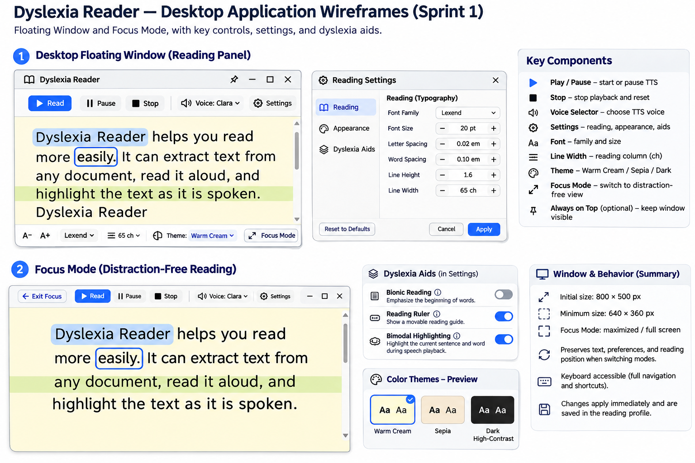
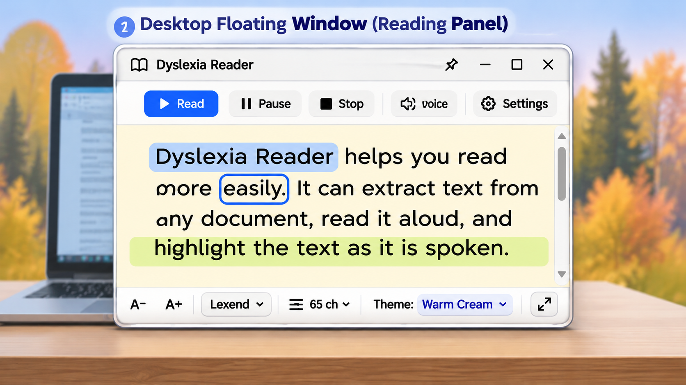
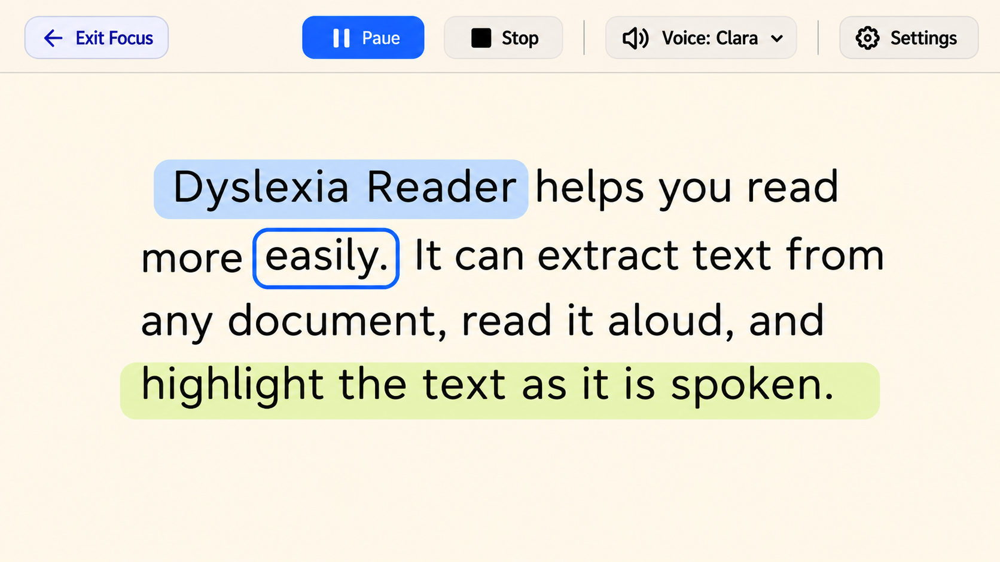

# Dyslexia Reader — Desktop Reader Wireframe Specifications

## 1. Overview

This document defines the proposed user interface structure and behavior for the Dyslexia Reader desktop application.

The desktop reader supports two primary reading modes:

1. **Floating Window:** A compact, resizable reading panel that displays OCR-extracted text alongside essential reading controls.
2. **Focus Mode:** An expanded, distraction-reduced reading environment that prioritizes text readability and user concentration.

Both modes share the same reading preferences and accessibility features.

These specifications are intended to guide the implementation of the native C++ desktop application. Layout dimensions and interaction details are initial UX proposals and may be refined during development and usability testing.

## 2. Design Goals

The desktop reader interface should:

- Provide a clear and predictable reading experience.
- Minimize unnecessary visual distractions.
- Support text-to-speech playback and synchronized highlighting.
- Allow users to customize fonts, spacing, line width and color themes.
- Provide easy access to dyslexia assistance features.
- Support keyboard-only navigation.
- Maintain consistent behavior between Floating Window and Focus Mode.
- Preserve the user's reading preferences when switching modes.

## 3. Floating Window

### 3.1 Purpose

The Floating Window is the default reading interface displayed after text has been extracted through OCR.

It allows users to read and listen to extracted content while continuing to interact with other desktop applications.

### 3.2 Layout Structure

The Floating Window is divided into three main areas:

| Area | Components |
|---|---|
| Header / Playback Toolbar | Play/Pause, Stop, Voice Selector, Reading Settings |
| Reading Area | OCR-extracted text, sentence highlighting, word highlighting, reading ruler |
| Bottom Toolbar | Font Selector, Font Size Controls, Theme Selector, Enter Focus Mode |

### 3.3 Header / Playback Toolbar

**Play/Pause**

- Starts text-to-speech playback from the current reading position.
- Changes to Pause while playback is active.
- Pauses playback without intentionally resetting the reading position.
- Resumes playback when activated again, if supported by the TTS engine.
- Must be implemented as a single control that changes its label and icon according to the current playback state.

**Stop**

- Stops text-to-speech playback.
- Clears the active playback state.
- Resets the playback position to the beginning of the current text or reading segment, according to the selected TTS implementation.

**Voice Selector**

- Displays the available text-to-speech voices.
- Allows the user to select a preferred voice.
- Only voices supported by the installed TTS engine are displayed.
- The behavior of voice changes during active playback must be defined during implementation.

**Reading Settings**

- Opens a settings panel containing additional reading preferences and accessibility controls.
- The panel must be accessible using both mouse and keyboard.
- Opening Settings must not automatically stop playback.

### 3.4 Reading Area

The Reading Area displays the extracted text using the currently selected reading profile.

It supports:

- Text wrapping.
- Vertical scrolling when the content exceeds the available height.
- Configurable font family and font size.
- Configurable letter spacing, word spacing and line height.
- Configurable maximum line width.
- Sentence and word highlighting during speech playback, when timing information is available.
- Optional Bionic Reading and Reading Ruler features.

Text should be left-aligned by default.

The Reading Area should maintain a clear visual hierarchy and avoid unnecessary decorative elements.

### 3.5 Bottom Toolbar

**Font Selector**

Allows the user to select one of the supported font families:

- Lexend
- Atkinson Hyperlegible
- OpenDyslexic

**Font Size Controls**

Allows users to increase or decrease the reading font size within the supported range of 14–48 pt.

The current font size should be visible to the user.

**Theme Selector**

Allows users to select one of the three supported themes:

- Warm Cream
- Sepia
- Dark High-Contrast

Theme changes should update the reading interface immediately.

**Enter Focus Mode**

Expands the reading interface into Focus Mode while preserving the current text, reading preferences and playback state whenever technically feasible.

### 3.6 Window Behavior

Proposed initial dimensions:

| Property | Value |
|---|---|
| Initial size | 800 × 500 px |
| Minimum size | 640 × 360 px |
| Reading Area padding | 24 px |
| Minimum interactive target size | 44 × 44 px (design target) |
| Resizable | Yes |
| Vertical scrolling | Yes |
| Always-on-top | Optional user-controlled behavior |

These values are initial design recommendations rather than fixed implementation constraints.

The layout should adapt when the window is resized.

Controls must remain accessible at the minimum supported window size. When horizontal space is insufficient, secondary controls may be moved into an accessible overflow menu.

## 4. Focus Mode

### 4.1 Purpose

Focus Mode provides an expanded reading environment designed to reduce distractions and improve concentration.

It prioritizes the reading content while keeping essential playback and accessibility controls available.

### 4.2 Layout Structure

Focus Mode consists of:

| Area | Components |
|---|---|
| Top Toolbar | Exit Focus Mode, Play/Pause, Stop, Voice Selector, Reading Settings |
| Main Reading Area | Centered reading column, OCR-extracted text, optional dyslexia aids |
| Optional Controls | Theme and font adjustments, accessible through Reading Settings |

### 4.3 Main Reading Area

The reading content should:

- Be displayed in a centered reading column.
- Remain left-aligned within that column.
- Respect the configured maximum line width.
- Use the currently selected font, spacing and color theme.
- Support vertical scrolling.
- Preserve the user's reading position when switching modes.

The surrounding interface should contain minimal visual distractions.

### 4.4 Toolbar Behavior

The Focus Mode toolbar should:

- Remain accessible through keyboard navigation.
- Provide the same playback functionality as Floating Window.
- Allow access to voice selection and reading settings.
- Include a clearly identifiable Exit Focus Mode control.

Secondary controls may be hidden or collapsed to reduce clutter, provided they remain discoverable and keyboard-accessible.

### 4.5 Entering and Exiting Focus Mode

When entering Focus Mode:

- Preserve the extracted text.
- Preserve the current reading profile.
- Preserve the current scroll or reading position where feasible.
- Preserve the TTS playback state where supported.
- Expand the interface into a maximized or full-screen reading view.

When exiting Focus Mode:

- Restore the Floating Window.
- Restore its previous dimensions and position where supported.
- Preserve the reading preferences.
- Preserve the current reading position where feasible.

The Escape key should provide a predictable way to exit Focus Mode when no higher-priority dismissible overlay is active.

## 5. Reading Settings Panel

The Reading Settings panel provides access to preferences that do not need to remain permanently visible in the main toolbar.

### 5.1 Typography Settings

| Setting | Supported Values | Default |
|---|---|---|
| Font Family | Lexend, Atkinson Hyperlegible, OpenDyslexic | Lexend |
| Font Size | 14–48 pt | 20 pt |
| Letter Spacing | 0–0.2 em | 0.02 em |
| Word Spacing | 0–0.5 em | 0.1 em |
| Line Height | 1–2.5 | 1.6 |
| Line Width | 35–100 ch | 65 ch |

### 5.2 Appearance Settings

Theme selection:

- Warm Cream
- Sepia
- Dark High-Contrast

The interface should use the semantic color tokens defined in `docs/contracts/color-themes.json`.

### 5.3 Dyslexia Assistance Settings

The following controls should be presented as independent toggles:

| Feature | Default |
|---|---|
| Bionic Reading | Off |
| Reading Ruler | Off |
| Bimodal Highlighting | On |

**Bionic Reading**

Visually emphasizes the beginning of words to provide an alternative reading presentation.

**Reading Ruler**

Displays a movable reading guide intended to help users follow the current line of text.

**Bimodal Highlighting**

Highlights text during speech playback when the TTS system provides sufficiently precise timing information.

When synchronized timing is unavailable, the interface must avoid displaying misleading word-level synchronization.

Detailed visual parameters for these features will be defined in a separate specification.

### 5.4 Settings Application and Persistence

Reading settings use immediate preview and automatic persistence.

- Changes should be reflected in the reading interface immediately.
- A separate Apply button is not required for standard reading preference changes.
- Updated preferences should remain consistent between Floating Window and Focus Mode.
- Changes should be saved through the application's reading profile persistence mechanism.
- A Reset to Defaults option may be provided, with appropriate confirmation when necessary.

## 6. Reading Profile Integration

Both reading modes must use the shared reading profile defined in:

`docs/contracts/reading-profile.schema.json`

Example profile:

```json
{
  "schemaVersion": 1,
  "fontFamily": "Lexend",
  "fontSizePt": 20,
  "letterSpacingEm": 0.02,
  "wordSpacingEm": 0.1,
  "lineHeight": 1.6,
  "lineWidthCh": 65,
  "theme": "warm-cream",
  "aids": {
    "bionicReading": false,
    "readingRuler": false,
    "bimodalHighlighting": true
  }
}
```

### 6.1 Profile Application

When a reading profile is loaded:

1. Apply the selected font family.
2. Apply font size and spacing values.
3. Apply the maximum reading line width.
4. Resolve the selected color theme.
5. Enable or disable the configured dyslexia aids.
6. Update the reading interface accordingly.

### 6.2 Profile Updates

Changes made through Reading Settings should:

- Update the current reading interface immediately.
- Remain consistent between Floating Window and Focus Mode.
- Be stored in the reading profile through the application's persistence mechanism.
- Be synchronized with the web dashboard when profile synchronization is available.

The JSON Schema `default` keywords document default values but do not automatically populate missing properties.

### 6.3 Session-Specific State

The following values are not part of the current reading profile contract:

- Floating Window size and screen position.
- Current OCR-extracted text.
- Current scroll position.
- TTS playback state.
- Current playback position.
- Selected TTS voice.

These values should be managed separately as application or session state.

If voice preferences or window preferences need to be synchronized in the future, the shared contract should be extended through a coordinated versioned change.

## 7. Keyboard Accessibility

Both reading modes must support keyboard-only interaction.

Requirements include:

- All interactive controls must be keyboard-focusable.
- Focus indicators must be visible in all three color themes.
- Tab order must follow the visual and logical order of controls.
- Buttons must support standard keyboard activation.
- Settings panels must be operable without a mouse.
- Keyboard focus must be restored appropriately after closing a panel or switching modes.
- Keyboard shortcuts must not interfere unnecessarily with operating system or assistive technology shortcuts.

The detailed tab order and shortcut mapping will be documented separately in the Keyboard Navigation & Shortcuts specification.

## 8. UI States and Error Handling

### 8.1 No Text Available

If no OCR-extracted text is available:

- Display an informative empty state.
- Disable playback controls that require text.
- Provide a clear way to initiate or repeat text extraction.

### 8.2 OCR Failure

If text extraction fails:

- Display an understandable error message.
- Allow the user to retry.
- Preserve previously available text where appropriate.

### 8.3 TTS Unavailable

If no compatible TTS engine or voice is available:

- Inform the user that speech playback is unavailable.
- Keep text reading and customization features functional.
- Avoid displaying playback as active.

### 8.4 Synchronization Unavailable

If word-level timing information is unavailable:

- Do not simulate inaccurate word-level highlighting.
- Continue audio playback where supported.
- Use sentence-level highlighting only if reliable sentence timing is available.

### 8.5 Loading States

During OCR processing or TTS initialization:

- Display a clear loading or processing indicator.
- Prevent duplicate operations when appropriate.
- Keep unrelated reading controls accessible where possible.
- Inform the user when processing is complete or fails.

## 9. Design Validation Checklist

Before implementation is considered complete, verify that:

- Floating Window contains the essential playback controls.
- Focus Mode provides an expanded, distraction-reduced reading interface.
- Play/Pause operates as a single state-dependent control.
- Voice selection is accessible in both modes.
- Font and theme controls are available.
- All three dyslexia aid toggles are accessible.
- Reading preferences are applied consistently.
- Settings changes are previewed immediately and persisted.
- Switching modes preserves reading context where feasible.
- The interface remains usable at the minimum supported window size.
- Keyboard-only navigation is possible.
- Focus indicators remain visible across all themes.
- Empty, loading, and error states are understandable.
- Text remains readable during highlighting.

## 10. Related Documents

- `docs/contracts/reading-profile.schema.json`
- `docs/contracts/reading-profile.example.json`
- `docs/contracts/color-themes.json`
- `docs/design/color-themes.md`

The final wireframe images should be stored in:

`docs/design/wireframes/`

These images visually illustrate the layout and behavior described in this document.

## 11. Visual Wireframes

The following conceptual wireframes illustrate the proposed desktop reading interfaces.

### 11.1 Desktop Reader Overview



The overview illustrates the relationship between Floating Window, Focus Mode, and the main reading controls.

### 11.2 Desktop Floating Window (Reading Panel)

The Floating Window provides a compact, resizable reading interface that can remain visible alongside other desktop applications.



### 11.3 Focus Mode (Distraction-Free Reading)

Focus Mode provides an expanded reading environment with a centered reading column and minimal distractions.



**Design Notes:**

These wireframes are conceptual UI mockups.

The written specifications define the intended component behavior, accessibility requirements and reading profile integration.

Some visual details may differ from the final implementation. 
