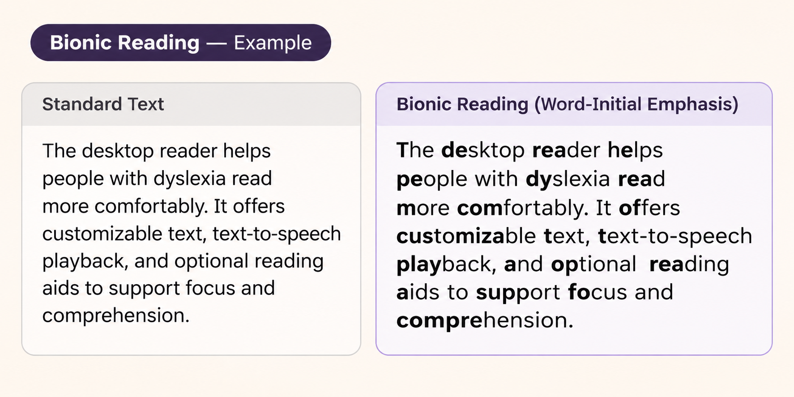
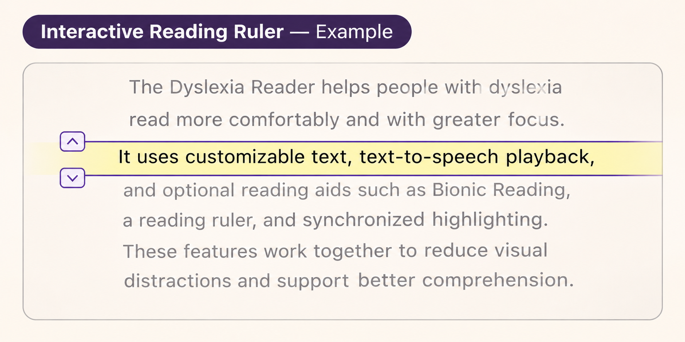
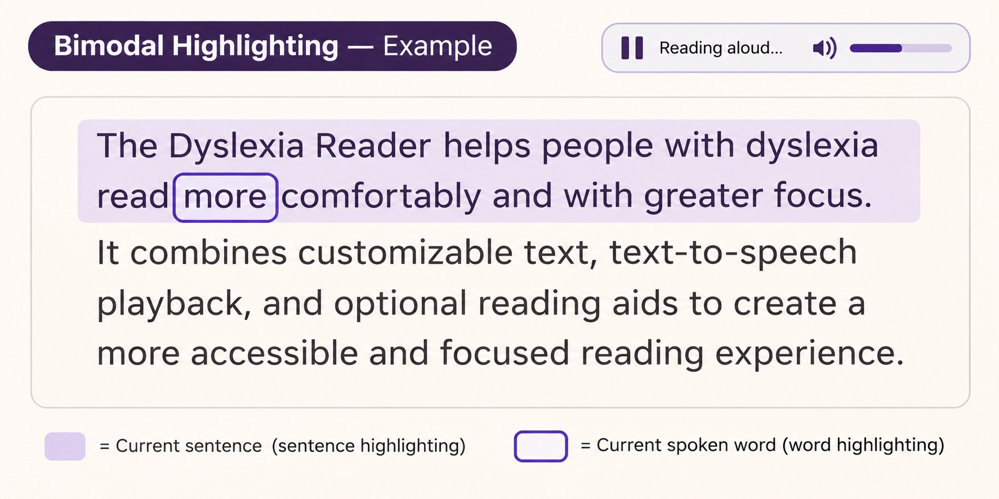

# Dyslexia Reader — Dyslexia Aid Visual Parameters

## 1. Overview

This document defines the proposed visual behavior and interaction parameters for three dyslexia assistance features in the Dyslexia Reader desktop application:

1. Bionic Reading
2. Interactive Reading Ruler
3. Bimodal Highlighting

The purpose of these features is to provide optional reading assistance while maintaining readability, accessibility and consistency across Floating Window and Focus Mode.

The parameters described in this document are initial design recommendations and should be refined through implementation testing and user feedback.

These features are not intended to provide a universal solution for dyslexia. Users should be able to enable or disable them independently according to their preferences.

## 2. Shared Design Principles

All three features should follow these principles:

- **Optional assistance:** Each feature can be enabled or disabled independently.
- **Consistency:** The same behavior should be maintained across Floating Window and Focus Mode.
- **Readability:** Visual effects must not obscure or distort the original text.
- **Accessibility:** Controls must remain operable using the keyboard.
- **Customization:** The interface should respect the selected reading profile and color theme.
- **Predictability:** Visual changes should follow clear, consistent rules.
- **Performance:** Effects should update smoothly without unnecessary layout shifts.
- **Graceful degradation:** Features that depend on unavailable capabilities should fail safely without affecting basic reading functionality.

The enabled or disabled state of each feature is stored in the shared reading profile.

## 3. Bionic Reading

### 3.1 Purpose

Bionic Reading is an optional text presentation technique that visually emphasizes the beginning of words.

The goal is to provide additional visual anchors that some users may find helpful when reading.

The feature must preserve the original text content, word order, punctuation and meaning.

**Visual reference:**



*Illustrative example of word-initial emphasis. The final implementation follows the parameters defined in this document.*

### 3.2 Visual Behavior

When Bionic Reading is enabled:

- The beginning of eligible words is displayed using a heavier font weight.
- The remaining characters retain the normal reading font weight.
- The original font family, size, spacing and color theme remain unchanged.
- The effect is applied consistently throughout the reading content.
- Disabling the feature restores normal text rendering.

The implementation must not modify the underlying OCR-extracted text.

### 3.3 Proposed Parameters

| Parameter | Initial Value | Description |
|---|---|---|
| Enabled by default | No | Matches the reading profile default |
| Emphasis ratio | 40% | Initial proportion of each eligible word to emphasize |
| Emphasis rounding | Ceiling | Rounds the calculated character count upward |
| Normal font weight | 400 | Used for non-emphasized characters |
| Emphasized font weight | 700 | Used for emphasized characters |
| Minimum eligible word length | 3 characters | Shorter words remain unchanged |
| Text color | Current theme text color | No additional color required |
| Animation | None | Avoids unnecessary visual movement |

These values are starting points for usability testing rather than established optimal settings.

### 3.4 Word Emphasis Rules

For an eligible word containing `n` characters, the initial number of emphasized characters is:

`emphasizedCount = ceil(n × 0.40)`

Examples:

| Word | Emphasized Characters | Visual Representation |
|---|---|---|
| reading | 3 | **rea**ding |
| accessibility | 6 | **access**ibility |
| focus | 2 | **fo**cus |
| text | 2 | **te**xt |
| to | 0 | to |

The character count should use Unicode-aware text segmentation rather than raw UTF-8 byte length.

Punctuation should remain visually unchanged.

For the initial implementation, emphasis should apply only to eligible alphabetic words. Handling of mixed alphanumeric text, abbreviations and language-specific cases should be tested separately.

### 3.5 Interaction with Other Features

Bionic Reading may be used together with Reading Ruler and Bimodal Highlighting.

When multiple effects are active:

- Bionic Reading controls font weight.
- Reading Ruler controls the visual emphasis of the selected line.
- Bimodal Highlighting controls playback-related sentence and word highlighting.

These effects should not overwrite one another.

The implementation should avoid text reflow or changes to the reading position when highlighting updates.

### 3.6 Accessibility Considerations

- Users must be able to disable Bionic Reading at any time.
- The original text must remain available to assistive technologies.
- Emphasis should not rely on color alone.
- The selected font must support distinguishable normal and emphasized weights.
- If the font does not support the required weights, the implementation should use the closest available weights without reducing readability.

## 4. Interactive Reading Ruler

### 4.1 Purpose

The Interactive Reading Ruler provides a visual guide that helps users focus on a selected line of text.

The ruler should reduce distractions from surrounding content without hiding or permanently altering the text.

**Visual reference:**



*Illustrative example of word-initial emphasis. The final implementation follows the parameters defined in this document.*

### 4.2 Visual Behavior

When Reading Ruler is enabled:

- A horizontal highlight follows the currently selected visual line.
- The selected line remains fully readable.
- Surrounding lines may be visually de-emphasized.
- The ruler can be moved using keyboard controls.
- The ruler adjusts automatically when text wrapping or font settings change.

The ruler should be positioned relative to rendered text lines rather than relying on a fixed number of characters.

### 4.3 Proposed Parameters

| Parameter | Initial Value | Description |
|---|---|---|
| Enabled by default | No | Matches the reading profile default |
| Highlight height | Current line height | Covers one rendered line |
| Vertical padding | 4 px | Additional space around the highlighted line |
| Horizontal padding | 8 px | Space around the reading column |
| Surrounding text dimming | 25% | Initial reduction in surrounding visual prominence |
| Highlight color | `rulerHighlight` | Resolved from the selected theme |
| Animation duration | 100 ms | Optional subtle movement transition |
| Keyboard navigation | Previous/next line | Moves the ruler between visual lines |

The dimming value is an initial design target and must be adjusted if it reduces text contrast below acceptable levels.

### 4.4 Keyboard Interaction

The Reading Ruler should support:

- Moving to the previous visual line.
- Moving to the next visual line.
- Maintaining its position while the user scrolls, where possible.
- Remaining visible when the selected line moves outside the viewport.

The final keyboard shortcuts must be defined in the Keyboard Navigation & Shortcuts specification.

Navigation shortcuts must avoid conflicts with standard text navigation and assistive technology commands.

### 4.5 Scrolling and Resizing

When the reading area is resized:

- The ruler should adapt to the updated text wrapping.
- Its position should remain associated with the closest corresponding text location.
- The selected line should remain visible whenever feasible.

When the user changes the font size or spacing, the ruler should be recalculated based on the new rendered line layout.

### 4.6 Accessibility Considerations

- The highlighted line must maintain sufficient text contrast.
- Surrounding text should remain readable.
- The ruler must not intercept or block standard text selection unnecessarily.
- Motion should be minimal and should respect reduced-motion preferences.
- The ruler should be usable without a mouse.
- Disabling the ruler should restore the normal reading presentation immediately.

## 5. Bimodal Highlighting

### 5.1 Purpose

Bimodal Highlighting visually follows text while it is being read aloud through text-to-speech.

The feature aims to help users associate spoken content with the corresponding written text.

It uses two levels of highlighting:

1. Current sentence highlighting.
2. Current spoken word highlighting.

**Visual reference:**



*Illustrative example of word-initial emphasis. The final implementation follows the parameters defined in this document.*

### 5.2 Visual Behavior

During TTS playback:

- The current sentence receives a subtle background highlight.
- The currently spoken word receives a more prominent visual indicator.
- Highlighting advances according to the timing information provided by the TTS engine.
- Previously spoken text returns to its normal appearance.
- Highlighting stops or pauses according to the playback state.

Word-level highlighting must only be used when sufficiently reliable word timing information is available.

### 5.3 Proposed Parameters

| Parameter | Initial Value | Description |
|---|---|---|
| Enabled by default | Yes | Matches the reading profile default |
| Sentence highlight color | `sentenceHighlight` | Resolved from the selected theme |
| Word highlight border | `wordHighlightBorder` | Resolved from the selected theme |
| Word border width | 2 px | Proposed visual indicator |
| Word border radius | 3 px | Slightly rounded border |
| Sentence highlight padding | 2 px | Subtle background separation |
| Highlight animation | None by default | Avoids introducing artificial synchronization delays |
| Auto-scroll | Enabled when necessary | Keeps active text visible |

Highlight colors must be resolved through the shared semantic theme definitions.

### 5.4 Sentence Highlighting

When reliable sentence timing is available:

- The current sentence is highlighted using the theme's `sentenceHighlight` color.
- The highlight follows sentence boundaries rather than arbitrary line breaks.
- Sentences spanning multiple rendered lines remain highlighted correctly.
- The background must not reduce the readability of the text.

Sentence highlighting should not be simulated when the TTS engine cannot provide or reliably derive sentence timing.

### 5.5 Word Highlighting

When reliable word timing is available:

- The currently spoken word receives a visible border.
- The border uses the theme's `wordHighlightBorder` color.
- The border follows the rendered position of the word.
- The word highlight updates as playback progresses.

The word indicator must remain distinguishable when Bionic Reading is also enabled.

If a word spans multiple visual lines, the implementation should correctly handle its rendered fragments.

### 5.6 Playback State Behavior

| Playback State | Highlight Behavior |
|---|---|
| Not started | No active playback highlight |
| Playing | Update sentence and word highlights using available timing |
| Paused | Preserve the current highlight without advancing |
| Resumed | Continue highlighting from the resumed playback position |
| Stopped | Clear active playback highlights |
| Completed | Clear active playback highlights |

The exact resume behavior depends on the capabilities of the selected TTS engine.

### 5.7 Timing Availability and Fallbacks

The implementation must distinguish between three situations.

**Case 1: Reliable word and sentence timing available**

- Enable sentence highlighting.
- Enable word highlighting.
- Keep visual updates synchronized with audio playback.

**Case 2: Reliable sentence timing only**

- Enable sentence highlighting.
- Disable word-level highlighting.
- Continue audio playback normally.

**Case 3: No reliable synchronization information**

- Continue audio playback where supported.
- Do not display simulated word or sentence synchronization.
- Keep the text readable without playback-related highlighting.

The interface must not present estimated timing as accurate synchronization without appropriate validation.

### 5.8 Auto-Scrolling

When the active sentence approaches the edge of the visible reading area:

- Scroll only as necessary to keep the active text visible.
- Avoid abrupt or excessive movement.
- Preserve the user's ability to scroll manually.
- Do not repeatedly override manual scrolling.

The precise behavior of automatic scrolling should be evaluated during usability testing.

### 5.9 Accessibility Considerations

- Highlighting must not rely exclusively on color.
- Word borders should remain visible across all supported themes.
- Highlighting must not cause text reflow.
- The interface must remain usable when TTS is unavailable.
- Users must be able to disable Bimodal Highlighting independently of audio playback.
- Reduced-motion preferences should be respected.

## 6. Combined Feature Behavior

The three dyslexia assistance features may be enabled simultaneously.

Each feature has a distinct visual responsibility:

| Feature | Primary Visual Responsibility |
|---|---|
| Bionic Reading | Font-weight emphasis within words |
| Reading Ruler | Highlighting the selected visual line |
| Bimodal Highlighting | Synchronizing sentence and word emphasis with speech |

When features overlap, the interface should preserve the readability of the active text.

### 6.1 Visual Priority

The proposed visual priority is:

1. Active spoken word indicator.
2. Active sentence highlight.
3. Reading Ruler highlight.
4. Bionic Reading font-weight emphasis.

This priority describes visual prominence rather than disabling lower-priority features.

Bionic Reading remains applied to the text even when the other features are active.

### 6.2 Avoiding Visual Conflicts

The implementation should:

- Avoid replacing text with duplicated highlighted copies.
- Avoid layout changes caused by active highlighting.
- Preserve readable text contrast when overlays overlap.
- Ensure the current spoken word remains distinguishable.
- Avoid excessive animation and visual noise.

If multiple background effects conflict, the active sentence highlight should remain clearly distinguishable, while the Reading Ruler effect may be reduced locally.

The exact compositing behavior should be validated against the supported color themes.

## 7. Reading Profile Integration

The feature toggles are defined in the shared reading profile contract:

`docs/contracts/reading-profile.schema.json`

Example:

```json
{
  "aids": {
    "bionicReading": false,
    "readingRuler": false,
    "bimodalHighlighting": true
  }
}
```

The values above represent the `aids` portion of the complete reading profile.

The current schema stores only the enabled or disabled state of each feature.

Detailed visual parameters are defined in this document as implementation-level design defaults.

If users need to customize parameters such as emphasis ratio, ruler dimming or highlight border width in a future version, the reading profile schema should be extended through a coordinated, versioned change.

## 8. Color Theme Integration

All visual effects must work with the three supported color themes:

- Warm Cream
- Sepia
- Dark High-Contrast

Theme definitions are stored in:

`docs/contracts/color-themes.json`

The following semantic color tokens are relevant:

| Token | Usage |
|---|---|
| `text` | Main reading text |
| `background` | Reading area background |
| `sentenceHighlight` | Current sentence background |
| `wordHighlightBorder` | Current spoken word indicator |
| `rulerHighlight` | Reading Ruler background |
| `focus` | Keyboard focus indicator |

The application should use these semantic tokens rather than hardcoded colors inside individual UI components.

Contrast must be evaluated for all relevant combinations, including overlapping highlights and dimmed text.

## 9. Performance and Rendering Requirements

The implementation should aim to:

- Avoid reprocessing the entire document on every TTS timing update.
- Update only the affected visual regions where feasible.
- Avoid unnecessary text reflow during playback.
- Recalculate rendered line positions when typography settings change.
- Keep reading position stable when switching between modes.
- Handle long OCR-extracted documents without excessive rendering delays.

Performance targets should be established through implementation benchmarks rather than assumed in advance.

## 10. Accessibility Validation Checklist

Before the dyslexia assistance features are considered ready for release, verify that:

- Each feature can be enabled and disabled independently.
- Feature defaults match the shared reading profile schema.
- Bionic Reading preserves the original text content.
- Bionic Reading does not introduce unnecessary layout shifts.
- Reading Ruler follows rendered visual lines.
- Reading Ruler is operable using the keyboard.
- Surrounding text remains readable when dimming is active.
- Bimodal Highlighting uses reliable timing information.
- Word-level highlighting is disabled when accurate timing is unavailable.
- Sentence-level highlighting is used only when reliable timing is available.
- Playback highlighting does not cause text reflow.
- Highlight colors remain distinguishable across all themes.
- Combined effects do not obscure the active text.
- Reduced-motion preferences are respected.
- The features behave consistently in Floating Window and Focus Mode.
- Users can continue reading when TTS is unavailable.

## 11. Related Documents

- `docs/contracts/reading-profile.schema.json`
- `docs/contracts/reading-profile.example.json`
- `docs/contracts/color-themes.json`
- `docs/design/color-themes.md`
- `docs/design/desktop-reader-wireframes.md`

The detailed keyboard controls will be defined in the Keyboard Navigation & Shortcuts specification.

## 12. Implementation Notes

This document defines the proposed UX behavior and initial visual parameters for dyslexia assistance features.

The values are intended to support consistent implementation across the desktop application and may be adjusted following accessibility reviews and usability testing.

The final implementation should prioritize user control, predictable behavior and readable text over decorative visual effects.