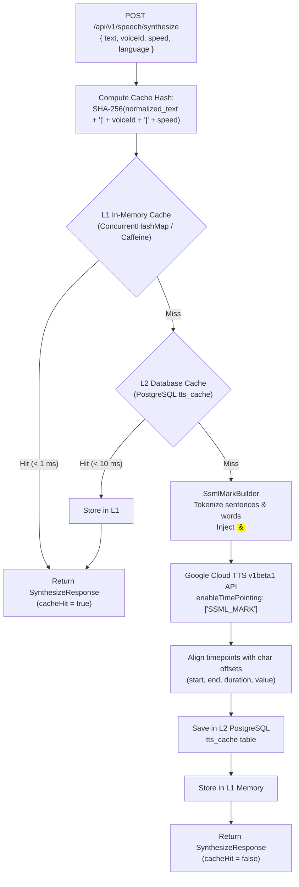
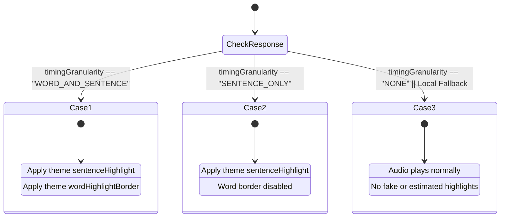

# Cloud Text-to-Speech (TTS), Server-Side Caching, and Local-First Fallback Architecture

## 1. Executive Summary & Design Principles

Dyslexia Reader provides a reading assistance experience centered around **Local-First Autonomy** complemented by **Optional Cloud Services**. A user reading text captured from their screen must never be impeded by network latency, server outages, expired quotas, or cloud configuration issues.

```text
+----------------------------------------------------------------------------------+
|                     Dyslexia Reader Ecosystem Architecture                       |
+----------------------------------------------------------------------------------+
|  Native C++ Desktop Client (Offline-First)       | Optional Spring Boot Backend  |
|  - Screen capture & local OCR                    | - User preferences sync       |
|  - DirectWrite / Direct2D reader                 | - Premium Cloud TTS API       |
|  - Windows SpeechSynthesizer (Offline Free)      | - Google Cloud TTS v1beta1    |
|  - %TEMP% audio cache (<cacheHash>.mp3)          | - L1 memory + L2 SQL cache    |
|  - Non-blocking background worker threads        | - Zero-log privacy policy     |
+----------------------------------------------------------------------------------+
```

### Core System Principles
1. **Free & Offline Independence**: The native C++ desktop application is 100% functional without an internet connection or platform account. Local speech synthesis via `Windows::Media::SpeechSynthesis::SpeechSynthesizer` is always available.
2. **Predictable Cloud Augmentation**: High-fidelity neural cloud voices are an opt-in enhancement. When chosen, requests to `POST /api/v1/speech/synthesize` return high-clarity audio alongside millisecond-level word and sentence synchronization marks.
3. **Fail-Safe Local Fallback**: Any cloud failure (HTTP 503, network disconnection, upstream quota exhaustion, timeout) transparently redirects audio generation to the local Windows TTS engine without interrupting the user.
4. **Deterministic Server-Side & Local Caching**: Identical synthesis requests are keyed by `SHA-256(normalized_text + "|" + voiceId + "|" + speed)`. Re-reading or replaying passages incurs **$0 API cost** and executes in under 10 milliseconds.
5. **Zero-Log Privacy Policy**: Captured user text is strictly confidential. The platform backend never writes raw text to server logs or long-term operational telemetry.
6. **No Fake Synchronization (`UI-12`, `BH-04`)**: The Bimodal Highlighting engine strictly adheres to reported `timingGranularity` (`WORD_AND_SENTENCE`, `SENTENCE_ONLY`, `NONE`). If accurate word boundaries are unavailable, word highlighting is omitted rather than simulated with estimated timer ticks.

---

## 2. Cloud TTS Provider Research & Comparative Pricing Analysis

To establish a sustainable operational model, the three leading cloud text-to-speech providers were evaluated against the project's language requirements: English (`en-US`, `en-GB`) and Romanian (`ro-RO`).

### 2.1 Pricing per 1 Million Characters (Published Standard Rates)

| Provider & Voice Tier | Price / 1M Characters | Monthly Free Tier Allowance | Target Quality / Latency |
|---|---|---|---|
| **Google Cloud TTS — Standard** | $4.00 | 4,000,000 characters / month | Concatenative / parametric; low latency |
| **Google Cloud TTS — WaveNet** | $16.00 | 1,000,000 characters / month | DeepMind WaveNet neural synthesis |
| **Google Cloud TTS — Neural2** | $16.00 | 1,000,000 characters / month | Next-gen DeepMind architecture, natural prosody |
| **Google Cloud TTS — Studio** | $160.00 | 100,000 characters / month | Specialized studio-narrated voices |
| **Amazon Polly — Standard** | $4.00 | 5,000,000 characters / month (first 12 mos) | Unit selection; basic speech marks |
| **Amazon Polly — Neural** | $16.00 | 1,000,000 characters / month (first 12 mos) | High naturalness, NTTS engine |
| **Amazon Polly — Generative** | $30.00 | None | Conversational, higher latency |
| **Azure AI Speech — Neural** | $15.00 | 500,000 characters / month (F0 tier) | High naturalness, wide language matrix |

### 2.2 Language Matrix & Romanian (`ro-RO`) Evaluation

| Locale | Google Cloud TTS | Amazon Polly | Microsoft Azure AI Speech |
|---|---|---|---|
| **English (US) `en-US`** | Neural2 (A–J), WaveNet (A–J), Journey, Studio | Neural (Joanna, Matthew, Danielle, etc.) | Neural (Jenny, Guy, Aria, etc.) |
| **English (UK) `en-GB`** | Neural2 (A–F), WaveNet (A–F) | Neural (Amy, Brian, Arthur) | Neural (Sonia, Ryan, Libby) |
| **Romanian `ro-RO`** | **`ro-RO-Wavenet-A` (Female)**, `ro-RO-Standard-A` | Standard only (`Carmen`), lacks native Neural | `ro-RO-AlinaNeural`, `ro-RO-EmilNeural` |

Romanian language support is critical for the target audience. Google Cloud TTS provides high-quality Romanian WaveNet synthesis (`ro-RO-Wavenet-A`) which accurately handles Romanian diacritics (`ă`, `â`, `î`, `ș`, `ț`) and phonetic stress patterns without unnatural robotic inflection.

### 2.3 Timestamp & Speech Mark Extraction Capabilities

| Feature | Google Cloud TTS (`v1beta1`) | Amazon Polly | Microsoft Azure AI Speech |
|---|---|---|---|
| **API Mechanism** | SSML custom `<mark>` tags via `enableTimePointing: ["SSML_MARK"]` | Dedicated speech mark JSON streams (`--output-format json`) | SDK `WordBoundary` events / SSML `<bookmark>` |
| **Single-Request Audio + Marks** | **Yes**: Base64 audio + `timepoints` array in a single JSON response | **No**: Requires two separate API requests (one for audio, one for marks) | REST API returns raw audio; marks require SDK or streaming |
| **Offset Precision** | Exact elapsed audio time in seconds (`timeSeconds`) per mark | Millisecond offset per word/sentence/viseme | Millisecond offset via SDK events |
| **Implementation Complexity** | Low: Deterministic text tokenization to inject `<mark>` elements | Medium: Dual request orchestration or stream multiplexing | High: Requires Azure Speech C++ SDK dependency in native client |

---

## 3. Decision Rationale: Why Google Cloud TTS `v1beta1` Was Selected

Google Cloud Text-to-Speech `v1beta1` was selected as the cloud provider for the following reasons:

1. **Personal GCP Credits & Zero Initial Cost**:
   The developer's active Google Cloud account and personal credits fund backend development, automated integration tests, and classroom demonstration quotas at zero out-of-pocket expense.
2. **Native Romanian WaveNet Support**:
   Google Cloud TTS provides `ro-RO-Wavenet-A`, ensuring Romanian native speakers experience the same natural reading rhythm as English readers using `en-US-Neural2-F`.
3. **Atomic Audio + Timing via `SSML_MARK`**:
   Google Cloud TTS `v1beta1` supports the `enableTimePointing` parameter:
   ```json
   {
     "input": {
       "ssml": "<speak><mark name=\"s_0\"/><mark name=\"w_0\"/>Dyslexia <mark name=\"w_1\"/>Reader</speak>"
     },
     "voice": {
       "languageCode": "en-US",
       "name": "en-US-Neural2-F"
     },
     "audioConfig": {
       "audioEncoding": "MP3",
       "speakingRate": 1.0
     },
     "enableTimePointing": ["SSML_MARK"]
   }
   ```
   The response returns both the MP3 payload in `audioContent` and the mark timestamps in `timepoints`:
   ```json
   {
     "audioContent": "//NExAAAA...",
     "timepoints": [
       { "markName": "s_0", "timeSeconds": 0.0 },
       { "markName": "w_0", "timeSeconds": 0.0 },
       { "markName": "w_1", "timeSeconds": 0.41 }
     ]
   }
   ```
4. **Isolated Credentials Architecture**:
   Neither the C++ desktop client nor the React web client requires GCP API keys. The Spring Boot backend acts as a secure, authenticated gateway that enforces rate limits and caches responses.

---

## 4. Server-Side Caching Architecture (`L1` + `L2`)

To eliminate duplicate provider costs, protect user allowances, and deliver instantaneous playback during repeated reading, the Spring Boot platform implements a two-tier caching architecture.



### 4.1 Cache Key Normalization
The cache key is calculated deterministically:
```text
cacheHash = SHA-256(normalized_text + "|" + voiceId + "|" + formatted_speed)
```
- **Text Normalization**: Leading and trailing whitespace is stripped. Consecutive interior spaces, tabs, and newlines are collapsed to a single space.
- **Speed Formatting**: Formatted with standard decimal precision (e.g., `1.0` or `1.00`).
- **Hash Format**: Lowercase 64-character hexadecimal string matching `^[a-f0-9]{64}$`.

### 4.2 Two-Tier Storage Hierarchy
1. **L1 In-Memory Cache**:
   - High-throughput, bounded LRU cache (`ConcurrentHashMap` or Caffeine).
   - Maximum capacity: 1,000 recent items.
   - Lifetime: Bounded by JVM runtime.
2. **L2 PostgreSQL Cache (`tts_cache`)**:
   - Table schema:
     ```sql
     CREATE TABLE tts_cache (
         cache_hash CHAR(64) PRIMARY KEY,
         normalized_text TEXT NOT NULL,
         voice_id VARCHAR(64) NOT NULL,
         speed NUMERIC(3, 2) NOT NULL,
         audio_mime_type VARCHAR(32) NOT NULL,
         audio_base64 TEXT NOT NULL,
         speech_marks_json TEXT NOT NULL,
         character_count INTEGER NOT NULL,
         created_at TIMESTAMP WITH TIME ZONE NOT NULL DEFAULT NOW(),
         expires_at TIMESTAMP WITH TIME ZONE NOT NULL
     );
     CREATE INDEX idx_tts_cache_expires_at ON tts_cache (expires_at);
     ```
   - Configurable TTL: Default 48 hours for demo/development environments, extendable to 30 days.

### 4.3 Zero-Log Privacy Policy
Screen-captured text may include sensitive documents, private emails, or personal reading material.
- **Backend Logging Rule**: Server logs must **never** include raw user text.
- **Permitted Log Metadata**:
  ```text
  INFO [SpeechSynthesisService] TTS synthesis cache=MISS hash=adf2c98a... voice=en-US-Neural2-F chars=68 lang=en-US durationMs=342
  ```

---

## 5. Local-First Fallback & Bimodal Highlighting Contract

The shared API contract maps directly to the three visual highlighting scenarios defined in `dyslexia-aids-visual-parameters.md` § 5.7:



### 5.1 Bimodal Synchronization Cases
1. **Case 1 (`WORD_AND_SENTENCE`)**:
   - Exact sentence and word start/end character offsets and millisecond timestamps are present.
   - DirectWrite / Direct2D renders the sentence background using `sentenceHighlight` and the active word indicator using `wordHighlightBorder`.
2. **Case 2 (`SENTENCE_ONLY`)**:
   - Sentence boundaries are verified, but word-level timestamps are unavailable.
   - Active sentence background is rendered; word border is omitted.
3. **Case 3 (`NONE`)**:
   - Audio plays, but timing synchronization is missing or unverified.
   - Text remains cleanly formatted in the selected reading profile. **Under no circumstances should the client simulate or guess word highlights using artificial timers (`UI-12`, `BH-04`).**

---

## 6. Local Disk Audio Caching in Native Client (`%TEMP%`)

The desktop client implements an on-disk cache in the Windows temporary directory:
- **File Path**: `%TEMP%\dyslexia-tts-<cacheHash>.mp3`
- **Replay Optimization**:
  1. User selects text and clicks Play.
  2. Native client computes `SHA-256(normalized_text + "|" + voiceId + "|" + speed)`.
  3. If `%TEMP%\dyslexia-tts-<cacheHash>.mp3` exists and metadata is present, audio plays immediately from disk with zero HTTP requests.
  4. If absent, the background worker thread sends the synthesis request to the platform backend, writes the received audio bytes to `%TEMP%`, and begins playback.

---

## 7. C++ Background Threading & Fallback Review Checklist (Roles 3, 4, 5)

This checklist serves as the architectural standard for developers implementing the native desktop client:

- [ ] **1. Non-Blocking Win32 UI Thread**:
  All network communication (`WinHttp`, `cpr`, or WinRT HTTP requests) and audio file decoding must execute on background worker threads (`std::async`, worker thread pool, or WinRT `IAsyncOperation`). The Win32 message loop (`GetMessage` / `DispatchMessage`) must never wait on network I/O, maintaining a 60+ FPS responsive UI for scrolling, dragging, and keyboard shortcuts.

- [ ] **2. Strict Network Timeout Budget**:
  HTTP client connection timeout must not exceed **3,000 ms**; read timeout must not exceed **8,000 ms**. A lagging internet connection must fail fast rather than hanging the reader.

- [ ] **3. Seamless Local TTS Fallback**:
  If the platform service returns HTTP `503 Service Unavailable`, `429 Too Many Requests`, a connection refused error, or a timeout:
  - Immediately redirect playback to local Windows `SpeechSynthesizer`.
  - Do **not** display a blocking modal error dialog.
  - Display a subtle status indicator in the reader toolbar: `Local Voice (Offline / Cloud Unavailable)`.
  - Begin local playback immediately so the user's reading flow is not disrupted.

- [ ] **4. Responsiveness to User Cancellation**:
  When the user clicks "Stop", changes the text selection, or closes the reader window, any pending background HTTP request must be aborted immediately and audio output halted.

- [ ] **5. Strict Adherence to Timing Granularity**:
  Inspect `timingGranularity` in the synthesis response. If the response indicates `SENTENCE_ONLY` or `NONE`, do not execute timer-based word guessing algorithms.

- [ ] **6. DirectWrite Character Range Mapping**:
  `SpeechMark.start` and `SpeechMark.end` represent zero-based UTF-16 character indices in the input text. Use `IDWriteTextLayout::HitTestTextRange` to calculate pixel bounding boxes for highlighting geometry without reflowing text.
